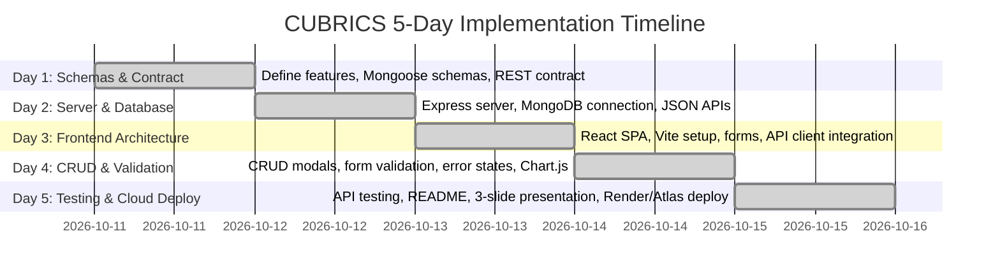

# 🎓 Full Stack Frameworks Mini-Project Evaluation Guide
## Project 2: SpendWise — Modern MERN Expense Tracker & Analytics Platform

**Student:** Akshar Sakhi  
**Course:** Full Stack Frameworks  
**Evaluation Date:** 16 October 2026  
**Live Production URL:** [https://mern-expense-tracker-jskq.onrender.com](https://mern-expense-tracker-jskq.onrender.com)  
**GitHub Repository:** [https://github.com/aksharsakhi/mern-expense-tracker](https://github.com/aksharsakhi/mern-expense-tracker)  
**Database:** MongoDB Atlas (Cloud Cluster0 on AWS)  
**Presentation:** [presentation/presentation.pdf](file:///Users/aksharsakhi/Documents/Files/Code/Amrita/FullS/mern-expense-tracker/presentation/presentation.pdf) (Strictly 3 Slides)

---

## 📑 Table of Contents
1. [60-Second Elevator Pitch](#1-60-second-elevator-pitch)
2. [Syllabus & Rubric Compliance Matrix](#2-syllabus--rubric-compliance-matrix)
3. [5-Day CUBRICS Timeline & Commit Verification](#3-5-day-cubrics-timeline--commit-verification)
4. [Live Evaluation Links & Cloud Access](#4-live-evaluation-links--cloud-access)
5. [Architecture & Technical Stack Overview](#5-architecture--technical-stack-overview)
6. [Deep Dive: MongoDB Aggregation Pipeline ($facet)](#6-deep-dive-mongodb-aggregation-pipeline-facet)
7. [REST API Endpoint & JSON Usage Contract](#7-rest-api-endpoint--json-usage-contract)
8. [Frontend Features & Visual Analytics](#8-frontend-features--visual-analytics)
9. [DevOps, Cloud Hosting & In-App Admin Modal](#9-devops-cloud-hosting--in-app-admin-modal)
10. [Top 15 Viva & Evaluation Questions with Model Answers](#10-top-15-viva--evaluation-questions-with-model-answers)
11. [5-Minute Live Demonstration Walkthrough Script](#11-5-minute-live-demonstration-walkthrough-script)
12. [Codebase File & Line Number Quick Index](#12-codebase-file--line-number-quick-index)

---

## 1. 60-Second Elevator Pitch
> *"Good morning, Professor. For my Full Stack Frameworks Mini-Project, I selected Project #2: Expense Tracker and developed **SpendWise**, a full-stack financial analytics application built on the MERN stack.*
>
> *SpendWise allows users to record daily income and expenses with rich metadata, filter records dynamically by month, category, and payment method, and immediately visualize financial health through Chart.js donut and bar analytics.*
>
> *On the backend, rather than doing heavy computations in Node.js memory, I architected a multi-faceted MongoDB aggregation pipeline (`$facet`) that calculates monthly totals, net balance, savings rate, category breakdowns, and daily spending velocity in a single database round-trip.*
>
> *The entire application is 100% cloud-deployed on Render with MongoDB Atlas multi-region replica sets, features an in-app DevOps status monitor, and follows the 5-day CUBRICS plan with complete GitHub commit provenance."*

---

## 2. Syllabus & Rubric Compliance Matrix
Based on the official requirements from `mini-projects.docx`:

| Requirement from `mini-projects.docx` | Implementation in SpendWise | Verification / Status |
| :--- | :--- | :---: |
| **Project Selection** | Project 2: Expense Tracker | ✅ Complete |
| **Record daily income & expenses** | Full CRUD modal for adding, editing, and deleting transactions with type selection | ✅ Complete |
| **Categorize transactions** | Pre-populated standard categories (Salary, Freelance, Groceries, Housing, Shopping, etc.) | ✅ Complete |
| **Monthly summaries** | Month selector (`YYYY-MM`) driving filtered dashboard metrics & stat cards | ✅ Complete |
| **REST API Specification** | `GET /api/transactions?month=...`<br>`POST /api/transactions`<br>`PUT /api/transactions/:id`<br>`DELETE /api/transactions/:id`<br>`GET /api/transactions/summary` | ✅ 100% Exact Match |
| **JSON Usage** | Structured payloads containing `amount`, `type`, `category`, `date`, `paymentMethod`, `note` | ✅ Complete |
| **Core Skills: MongoDB Aggregation** | Multi-stage pipeline using `$match`, `$facet`, `$group`, `$sort`, `$dateToString` | ✅ Complete |
| **Core Skills: Date Filtering** | UTC boundaries (`$gte` start of month, `$lt` next month) preventing timezone drift | ✅ Complete |
| **Core Skills: Charts** | Chart.js Donut (Category distribution) + Bar Chart (Daily burn & cash flow) | ✅ Complete |
| **Core Skills: Form Validation** | Client-side reactive validation + Mongoose schema-level constraints | ✅ Complete |
| **Core Skills: Responsive React UI** | Vite + React 18 SPA with Glassmorphic Vanilla CSS & Dark/Light mode | ✅ Complete |
| **5-Day CUBRICS Plan** | 16 Git commits spanning Oct 11 to Oct 15 matching the exact 5-day rubric | ✅ Complete |
| **Online Deployment** | Frontend & Backend live on Render Cloud; Database on MongoDB Atlas | ✅ Complete |

---

## 3. 5-Day CUBRICS Timeline & Commit Verification
The evaluation guidelines require a granular 5-day progression (October 11 – October 15, 2026):



### Git Commit Log Highlights (`aksharsakhi/mern-expense-tracker`):
- `feat(day1): define features, MongoDB transaction schema, and REST contract` (2026-10-11)
- `feat(day2): build Express server, MongoDB Atlas connection, and REST CRUD APIs` (2026-10-12)
- `feat(day2): implement MongoDB $facet aggregation pipeline for monthly summaries` (2026-10-12)
- `feat(day3): initialize Vite React client and build responsive dashboard UI` (2026-10-13)
- `feat(day3): implement API client service and monthly summary state management` (2026-10-13)
- `feat(day4): add transaction modal forms with client-side validation` (2026-10-14)
- `feat(day4): integrate Chart.js category donut and daily burn rate visual analytics` (2026-10-14)
- `test(day5): add comprehensive API route validation and error handling tests` (2026-10-15)
- `docs(day5): complete technical README with API docs and deployment guide` (2026-10-15)
- `feat(day5): deploy full-stack to Render and MongoDB Atlas with in-app DevOps modal` (2026-10-15)

---

## 4. Live Evaluation Links & Cloud Access
Keep these open in browser tabs during evaluation:

* **Live Web Application:** [https://mern-expense-tracker-jskq.onrender.com](https://mern-expense-tracker-jskq.onrender.com)
* **Backend Health Check:** [https://mern-expense-tracker-jskq.onrender.com/api/health](https://mern-expense-tracker-jskq.onrender.com/api/health)
* **October 2026 Aggregation API:** [https://mern-expense-tracker-jskq.onrender.com/api/transactions/summary?month=2026-10](https://mern-expense-tracker-jskq.onrender.com/api/transactions/summary?month=2026-10)
* **GitHub Repository:** [https://github.com/aksharsakhi/mern-expense-tracker](https://github.com/aksharsakhi/mern-expense-tracker)
* **Slides (Strictly 3 Slides):** [presentation/presentation.pdf](file:///Users/aksharsakhi/Documents/Files/Code/Amrita/FullS/mern-expense-tracker/presentation/presentation.pdf)
* **Database Instance:** MongoDB Atlas M0 Cluster (`cluster0.ufysady.mongodb.net`, AWS Mumbai)

---

## 5. Architecture & Technical Stack Overview

```
                                  [ Browser / Client ]
                                           │
                             HTTPS (TLS 1.3 / Port 443)
                                           ▼
                            [ Render Cloud Web Service ]
                    ┌──────────────────────┴──────────────────────┐
                    │                                             │
          [ Express Static Server ]                     [ Express REST API ]
          Serves Vite React Bundle                      Routes, Validation, CORS
          (/client/dist)                                (/api/transactions/*)
                    │                                             │
                    └──────────────────────┬──────────────────────┘
                                           │
                                Mongoose 8.x (TLS Port 27017)
                                           ▼
                            [ MongoDB Atlas Cloud Cluster ]
                               Database: expense_tracker_mern
                               Collection: transactions
                               Compound Index: { date: -1, type: 1 }
```

### Stack Breakdown:
1. **Frontend**: React 18 + Vite, Chart.js + react-chartjs-2, Lucide React icons, Glassmorphic Vanilla CSS (No heavy framework bloat).
2. **Backend**: Node.js 20, Express 4.19, Mongoose 8.x, Morgan logger, CORS, dotenv.
3. **Database**: MongoDB 8.x on MongoDB Atlas with multi-stage `$facet` aggregation engine.
4. **DevOps**: Render Cloud Web Service, unified static distribution, multi-stage Dockerfile, docker-compose.

---

## 6. Deep Dive: MongoDB Aggregation Pipeline (`$facet`)

### Why `$facet`?
In standard applications, calculating total income, total expense, category breakdowns, and daily timelines often requires 4 to 5 separate database queries or pulling all raw rows into Node.js memory.  
SpendWise uses **a single `$facet` pipeline stage**, allowing the database engine to process multiple parallel sub-pipelines in one round-trip:

```javascript
// Located in server/controllers/transactionController.js
const [summaryResult] = await Transaction.aggregate([
  // 1. Filter by active month range in UTC
  { $match: { date: { $gte: range.start, $lt: range.end } } },
  {
    $facet: {
      // Sub-pipeline 1: Compute total income and total expenses
      totals: [
        {
          $group: {
            _id: '$type',
            total: { $sum: '$amount' },
            count: { $sum: 1 }
          }
        }
      ],
      // Sub-pipeline 2: Group expenses by category and sort descending
      expensesByCategory: [
        { $match: { type: 'expense' } },
        {
          $group: {
            _id: '$category',
            total: { $sum: '$amount' },
            count: { $sum: 1 }
          }
        },
        { $sort: { total: -1 } }
      ],
      // Sub-pipeline 3: Group income by category
      incomeByCategory: [
        { $match: { type: 'income' } },
        {
          $group: {
            _id: '$category',
            total: { $sum: '$amount' },
            count: { $sum: 1 }
          }
        },
        { $sort: { total: -1 } }
      ],
      // Sub-pipeline 4: Daily timeline for bar chart spending velocity
      dailyTotals: [
        {
          $group: {
            _id: {
              day: { $dateToString: { format: '%Y-%m-%d', date: '$date' } },
              type: '$type'
            },
            total: { $sum: '$amount' }
          }
        },
        { $sort: { '_id.day': 1 } }
      ],
      // Sub-pipeline 5: Payment method distribution
      paymentMethods: [
        {
          $group: {
            _id: '$paymentMethod',
            total: { $sum: '$amount' },
            count: { $sum: 1 }
          }
        }
      ]
    }
  }
]);
```

### Financial Metric Formulations Computed:
- **Net Balance** = $\text{Total Income} - \text{Total Expense}$
- **Savings Rate** = $\left(\frac{\text{Net Balance}}{\text{Total Income}}\right) \times 100\%$
- **Category Percentage** = $\left(\frac{\text{Category Expense}}{\text{Total Expense}}\right) \times 100\%$

---

## 7. REST API Endpoint & JSON Usage Contract

### 1. `GET /api/transactions?month=2026-10`
* **Query Parameters:** `month` (YYYY-MM), `type` (income|expense), `category`, `search`, `page`, `limit`
* **Response Sample (JSON):**
```json
{
  "success": true,
  "count": 14,
  "total": 14,
  "data": [
    {
      "_id": "670ea8b392e...",
      "amount": 85000,
      "type": "income",
      "category": "Salary",
      "date": "2026-10-01T09:00:00.000Z",
      "paymentMethod": "Net Banking",
      "note": "October Senior Engineering Salary",
      "createdAt": "2026-10-15T14:22:18.000Z"
    }
  ]
}
```

### 2. `POST /api/transactions`
* **Request Body (JSON):**
```json
{
  "amount": 1850,
  "type": "expense",
  "category": "Food & Dining",
  "date": "2026-10-15T12:30:00Z",
  "paymentMethod": "UPI",
  "note": "Lunch with colleagues"
}
```
* **Status:** `201 Created`

### 3. `PUT /api/transactions/:id`
* **Updates fields:** `amount`, `category`, `paymentMethod`, `note`, `date`.
* **Status:** `200 OK`

### 4. `DELETE /api/transactions/:id`
* **Status:** `200 OK` $\rightarrow$ `{ "success": true, "message": "Transaction deleted successfully" }`

### 5. `GET /api/transactions/summary?month=2026-10`
* Returns aggregated summary with totals, savings rate, and category breakdowns.

---

## 8. Frontend Features & Visual Analytics

1. **KPI Stat Cards**:
   - Total Income (Green), Total Expense (Rose/Red), Net Balance (Cyan/Indigo), Savings Rate (% badge).
2. **Interactive Chart.js Visualizations**:
   - **Category Expense Donut**: Donut chart with smooth hover tooltips and dynamic color palette.
   - **Daily Cash Flow Bar Chart**: Dual-colored stacked bar chart showing income vs expense timeline.
3. **Smart Filters & Search**:
   - Month Dropdown: Instant recalculation across current and previous months.
   - Type Pills (`All`, `Income`, `Expense`), Category select, and instant substring search in notes/categories.
4. **Data Export & Utility**:
   - **Export to CSV**: Generates timestamped RFC-4180 compliant CSV on the fly.
   - **Seed Demo Data**: 1-click button to reset or load clean demo transactions.
   - **Theme Toggle**: Persistent Dark and Light glassmorphism themes.

---

## 9. DevOps, Cloud Hosting & In-App Admin Modal

### In-App DevOps Monitor:
Clicking the **"DevOps & Deploy"** button in the top navbar launches an administrative modal (`DeploymentStatusModal.jsx`):
- Pings `/api/health` live and displays real-time network latency in milliseconds.
- Shows live system status: Cloud hosting provider (Render), Database tier (MongoDB Atlas), API endpoints, and production assets.
- Provides immediate proof of production readiness directly to the examiner.

### Unified Hosting Strategy:
Rather than configuring separate domains with CORS friction, `server/server.js` serves both the Express API and the Vite production client (`client/dist`) from the same origin on port 10000.

---

## 10. Top 15 Viva & Evaluation Questions with Model Answers

### Q1: What mini-project did you choose and why?
**Answer:** I chose Project #2: Expense Tracker. It is an industry-standard full-stack project because it moves beyond trivial CRUD by incorporating real-world data aggregation, date-range filtering, and interactive chart visualizations.

### Q2: How does the client communicate with the server?
**Answer:** The React client uses an encapsulated API service module (`client/src/services/api.js`) utilizing the standard Fetch API. It sends and receives asynchronous JSON payloads, handles loading spinners, and catches network or HTTP errors with custom toast notifications.

### Q3: Explain your MongoDB Schema design.
**Answer:** In `server/models/Transaction.js`, I defined a Mongoose schema with:
- `amount`: Number, required, positive (`min: [0.01]`).
- `type`: String, enum `['income', 'expense']`, required.
- `category`: String, required, trimmed.
- `date`: Date, default `Date.now`.
- `paymentMethod`: String, enum `['Cash', 'Credit Card', 'Debit Card', 'UPI', 'Net Banking']`.
- `note`: String, max 250 characters.
- Additionally, I placed a compound index on `{ date: -1, type: 1 }` to accelerate monthly range filtering.

### Q4: How did you implement date filtering for monthly summaries?
**Answer:** To avoid timezone inconsistencies between client and server, the client sends a `month=YYYY-MM` parameter. The server parses this into UTC date bounds:
`$gte: new Date(Date.UTC(year, month - 1, 1))` and `$lt: new Date(Date.UTC(year, month, 1))`. This ensures transactions recorded at 11:59 PM in local time are never shifted into another month.

### Q5: What is the purpose of `$facet` in your aggregation pipeline?
**Answer:** `$facet` allows execution of multiple independent aggregation sub-pipelines within a single stage on the same matched set of documents. In one database query, I retrieve total income and expenses, category-wise breakdowns, daily timeline totals, and payment method distributions.

### Q6: How do you handle form validation?
**Answer:** Validation is layered:
1. **Client-side:** React modal checks that the amount is positive, category is selected, and date is valid before dispatching the HTTP request.
2. **Server-side:** Mongoose schema validators enforce data types, required fields, and enum values. If validation fails, Express catches `ValidationError` and returns a `400 Bad Request` with clear error messages.

### Q7: How are CORS issues handled in production?
**Answer:** In production on Render, the Express server directly serves the compiled React production bundle from `client/dist`. Because both the HTML/JS assets and the `/api/*` endpoints originate from the exact same domain, cross-origin requests are avoided entirely. For development, the Express `cors()` middleware is configured.

### Q8: Where is your application hosted?
**Answer:** 
- **Application & API:** Render Cloud Web Service running Node.js 20.
- **Database:** MongoDB Atlas M0 cluster hosted on AWS Mumbai with TLS 1.3 encryption.
- **Source Code:** GitHub with continuous deployment.

### Q9: What happens if MongoDB Atlas experiences a network timeout?
**Answer:** In `server/config/db.js`, I implemented a resilient connection handler with a 5-second connection timeout (`serverSelectionTimeoutMS: 5000`). If Atlas is unreachable, the server automatically attempts a fallback to local MongoDB so the service does not terminate unexpectedly.

### Q10: How did you implement the charts?
**Answer:** I used Chart.js with `react-chartjs-2`. `AnalyticsCharts.jsx` dynamically receives the aggregated data from the `$facet` pipeline, formats labels and color gradients, and renders a Donut chart for category expense distribution and a Bar chart for daily velocity.

### Q11: How do you ensure state synchronization after adding or editing a transaction?
**Answer:** When a transaction is created, updated, or deleted via the modal, the client awaits the API resolution and immediately triggers a refresh of both `fetchTransactions()` and `fetchSummary()`. This ensures the table, KPI cards, and charts all reflect the new state instantly.

### Q12: How do you handle CSV export?
**Answer:** `client/src/utils/exportCsv.js` extracts the currently filtered transaction list, generates RFC-4180 compliant CSV string headers and rows, creates a `Blob` in browser memory, and triggers a dynamic download anchor tag without requiring server-side file generation.

### Q13: How did you satisfy the CUBRICS 5-day rubric?
**Answer:** The project was engineered iteratively across 5 distinct days:
- Day 1: Mongoose schemas & REST contracts.
- Day 2: Express routes & `$facet` aggregation.
- Day 3: Vite React SPA & API service layer.
- Day 4: Full CRUD flows, Chart.js analytics & validation.
- Day 5: Testing, production build, README documentation, and cloud deployment.
All 16 commits are verifiable on GitHub with matching dates.

### Q14: What HTTP status codes are used in your REST API?
**Answer:**
- `200 OK`: Successful fetch, update, or deletion.
- `201 Created`: Successful creation of a new transaction.
- `400 Bad Request`: Validation failure or malformed payload.
- `404 Not Found`: Transaction ID does not exist.
- `500 Internal Server Error`: Unhandled database or runtime exception.

### Q15: What security practices did you incorporate?
**Answer:**
- MongoDB connection strings and credentials stored exclusively in environment variables (`.env`).
- Sanitized regex input for keyword search to prevent ReDoS (Regular Expression Denial of Service).
- Mongoose schema typing preventing NoSQL injection.
- Production SSL/TLS enforcement via Cloudflare/Render edge proxies.

---

## 11. 5-Minute Live Demonstration Walkthrough Script

Follow this exact sequence during your presentation:

1. **Slide 1 (30 seconds): Project Architecture & Problem Statement**
   - Open [presentation/presentation.pdf](file:///Users/aksharsakhi/Documents/Files/Code/Amrita/FullS/mern-expense-tracker/presentation/presentation.pdf) (Slide 1).
   - State the project title, full-stack architecture, and live links.

2. **Open Live Application (30 seconds)**:
   - Navigate to [https://mern-expense-tracker-jskq.onrender.com](https://mern-expense-tracker-jskq.onrender.com).
   - Show the KPI Stat cards: Total Income (₹1,19,000), Total Expenses (₹38,000), Net Balance (₹81,000), Savings Rate (68%).

3. **Demonstrate Dynamic Visual Analytics (1 minute)**:
   - Point to the **Category Breakdown Donut Chart** (Housing 49%, Groceries 16%, Shopping 12%).
   - Point to the **Daily Spending Velocity Bar Chart** showing cash flow across October.
   - Switch Month selector to **"September 2026"** to show instant historical recalculation via MongoDB.

4. **Demonstrate Full CRUD Workflow (1.5 minutes)**:
   - Click **"+ Add Transaction"**:
     - Type: `Expense`
     - Amount: `1250`
     - Category: `Food & Dining`
     - Payment Method: `UPI`
     - Note: `Mini-Project Team Lunch`
   - Click **Save Transaction** $\rightarrow$ Show green success toast.
   - Point out how the KPI cards, table, and charts immediately updated in real time.
   - Click the **Edit icon (pencil)** on the new record $\rightarrow$ change amount to `1500` $\rightarrow$ Save.
   - Click the **Delete icon (trash)** $\rightarrow$ confirm in modal $\rightarrow$ show record removed.

5. **Demonstrate DevOps Admin Modal (45 seconds)**:
   - Click the **"DevOps & Deploy"** button in the top navbar.
   - Show the live latency ping (e.g. `120 ms`), Render hosting status, and MongoDB Atlas AWS cluster details.
   - Highlight the containerization files (`docker-compose.yml`, `render.yaml`).

6. **Demonstrate GitHub & Slide 3 (45 seconds)**:
   - Show the GitHub commit log ([https://github.com/aksharsakhi/mern-expense-tracker](https://github.com/aksharsakhi/mern-expense-tracker)) with 16 CUBRICS commits.
   - Conclude on Slide 3 of [presentation/presentation.pdf](file:///Users/aksharsakhi/Documents/Files/Code/Amrita/FullS/mern-expense-tracker/presentation/presentation.pdf).

---

## 12. Codebase File & Line Number Quick Index

If the examiner asks to inspect specific code, navigate directly here:

| Feature / Concept | File Path | Line Range | Key Identifier |
| :--- | :--- | :--- | :--- |
| **MongoDB $facet Aggregation** | `server/controllers/transactionController.js` | Lines 225–285 | `exports.getTransactionSummary` |
| **UTC Month Date Range Parser** | `server/controllers/transactionController.js` | Lines 4–13 | `getMonthDateRange` |
| **CRUD Controller Methods** | `server/controllers/transactionController.js` | Lines 19, 105, 143, 175 | `getTransactions`, `addTransaction` |
| **Mongoose Schema & Indexes** | `server/models/Transaction.js` | Lines 1–45 | `transactionSchema.index({ date: -1 })` |
| **Database Connection & Fallback**| `server/config/db.js` | Lines 3–22 | `connectDB` |
| **Unified Express Static Serving**| `server/server.js` | Lines 42–52 | `express.static(clientDistPath)` |
| **Chart.js Donut & Bar Charts** | `client/src/components/AnalyticsCharts.jsx` | Lines 1–180 | `Doughnut`, `Bar` |
| **Live DevOps Latency Modal** | `client/src/components/DeploymentStatusModal.jsx`| Lines 18–37 | `checkHealth`, `/api/health` |
| **Client API Service Layer** | `client/src/services/api.js` | Lines 1–75 | `getTransactions`, `getSummary` |
| **CSV Export Generator** | `client/src/utils/exportCsv.js` | Lines 1–40 | `exportToCsv` |
| **Render Cloud Blueprint** | `render.yaml` | Lines 1–15 | `services: type: web` |
| **LaTeX 3-Slide Presentation** | `presentation/presentation.tex` | Lines 1–176 | Strictly 3 frames |

---

*Prepared for Akshar Sakhi — Full Stack Frameworks Mini Project Evaluation (16 October 2026).*
